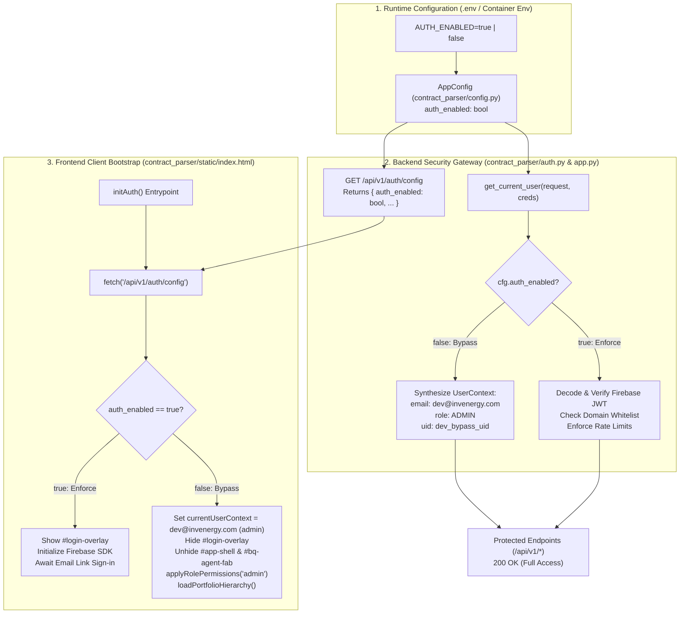

# Change Request CR-10: Zero-Friction Customer Handover & Authentication Toggle Architecture (`AUTH_ENABLED`)

* **CR ID:** `CR-010` (Configurable Identity Gateway & Customer Evaluation Handover — `AUTH_ENABLED` Toggle System)
* **Status:** Drafted via `/egm-draft` — Architecture & Handover Specification
* **Parent Architecture:** [DESIGN_DOC.md](file:///usr/local/google/home/prasannaankem/Code/Invenergy/Design/DESIGN_DOC.md), [CR7_ENTERPRISE_EMAIL_LINK_AUTH.md](file:///usr/local/google/home/prasannaankem/Code/Invenergy/Design/CR7_ENTERPRISE_EMAIL_LINK_AUTH.md), [CR8_ENTERPRISE_OBSERVABILITY_AND_DISTRIBUTED_TRACING.md](file:///usr/local/google/home/prasannaankem/Code/Invenergy/Design/CR8_ENTERPRISE_OBSERVABILITY_AND_DISTRIBUTED_TRACING.md), [CR9_REGIONAL_TEMPLATE_STUDIO_AND_CANONICAL_AST_REGISTRY.md](file:///usr/local/google/home/prasannaankem/Code/Invenergy/Design/CR9_REGIONAL_TEMPLATE_STUDIO_AND_CANONICAL_AST_REGISTRY.md)
* **Confirmed Architectural Decisions:**
  1. **Single Canonical Toggle Control (`AUTH_ENABLED`):**
     Standardizes all identity gating across backend and frontend to a single environment variable: `AUTH_ENABLED` (boolean, defaults to `true`). Avoids proliferation of disparate flags or separate mock identity parameters.
  2. **Deterministic Administrative Bypass Context (`UserContext`):**
     When `AUTH_ENABLED=false`, the backend authorization dependency ([`contract_parser/auth.py`](file:///usr/local/google/home/prasannaankem/Code/Invenergy/contract_parser/auth.py)) automatically yields a static `UserContext(email="dev@invenergy.com", role=UserRole.ADMIN, domain="invenergy.com", uid="dev_bypass_uid")` without inspecting or requiring HTTP `Authorization` headers.
  3. **Zero-Network Decoupled Frontend Bootstrapping:**
     The frontend client ([`contract_parser/static/index.html`](file:///usr/local/google/home/prasannaankem/Code/Invenergy/contract_parser/static/index.html)) fetches `/api/v1/auth/config` at startup. When `auth_enabled: false` is returned, it completely bypasses Firebase client SDK initialization, suppresses the `#login-overlay` modal, reveals the `#app-shell`, and assigns administrative DOM capabilities immediately without issuing any external calls to Google Identity Toolkit.
  4. **Strict Isolation of Production Security (`AUTH_ENABLED=true`):**
     Ensures that production environments deploying with `AUTH_ENABLED=true` (or when the variable is omitted) maintain 100% adherence to CR-7 Zero-Trust perimeter enforcement, domain-gated link dispatch (`@google.com`, `@invenergy.com`), rate limiting, and cryptographic JWT verification.
  5. **Turnkey Customer Evaluation Documentation:**
     Updates [`.env.example`](file:///usr/local/google/home/prasannaankem/Code/Invenergy/.env.example) and [README.md](file:///usr/local/google/home/prasannaankem/Code/Invenergy/README.md) with explicit handover recipes showing customer developers how to run the container or local development server in evaluation mode with zero external cloud dependencies.

---

## 1. Operational Context & Customer Handover Problem

### 1.1 The Customer Delivery Challenge
When shipping the Invenergy Contract Intelligence codebase to customer development teams, external evaluators, or client legal engineering groups, the primary obstacle to immediate adoption is external cloud identity dependencies:

1. **GCP Identity Platform Provisioning Friction:**
   The production authentication system ([`CR-7`](file:///usr/local/google/home/prasannaankem/Code/Invenergy/Design/CR7_ENTERPRISE_EMAIL_LINK_AUTH.md)) requires a configured Firebase / Google Cloud Identity Platform instance, a Web API Key, authorized redirect domains, and verified sender templates. External engineering teams evaluating the codebase on their local workstations or inside isolated corporate VPCs do not possess these credentials on Day 1.
2. **Blocked Local Verification:**
   Requiring valid Firebase credentials to run integration tests, inspect contract parsing output, or evaluate the UI blocks customer evaluation before they can even test core contract intelligence features.
3. **Need for Clean Single-Variable Control:**
   The customer requires an explicit, clean, single configuration toggle (`AUTH_ENABLED`) that cleanly disables authentication across both frontend and backend without requiring changes to application code, Dockerfiles, or database schemas.

### 1.2 Handover Requirements
* **Single Configuration Switch:** Toggling `AUTH_ENABLED=false` must completely remove all login walls.
* **Full Application Access:** In disabled mode, the user must be granted administrative permissions to test all features (PDF upload, AST tree inspection, BigQuery Data Agent, CSV export, and Regional Template Studio).
* **Zero Security Regression in Production:** When `AUTH_ENABLED=true`, full CR-7 passwordless token verification and domain gating must remain enforced.

---

## 2. Technical Architecture & Control Flow

### 2.1 Dual-State Flow Architecture



---

## 3. Detailed Component Specifications

### 3.1 Configuration Layer (`contract_parser/config.py`)
The configuration dataclass parses the environment variable with flexible boolean parsing (supporting `true`, `1`, `yes`, `false`, `0`, `no`):

* **Field Definition:** `auth_enabled: bool`
* **Default Value:** `True` (secure by default; production deployments remain protected if the variable is omitted).
* **Extraction Logic:**
  ```python
  auth_enabled: bool = field(
      default_factory=lambda: os.getenv("AUTH_ENABLED", "true").lower() in ("true", "1", "yes")
  )
  ```

### 3.2 Backend Authorization Dependency (`contract_parser/auth.py`)
All protected FastAPI routes depend on `get_current_user` (or `require_admin`). The dependency checks `auth_enabled` as its initial pre-flight gate:

1. **Bypass Branch (`auth_enabled == False`):**
   * Skips extracting `HTTPAuthorizationCredentials`.
   * Skips all network and cryptographic operations.
   * Returns:
     ```python
     UserContext(
         email="dev@invenergy.com",
         role=UserRole.ADMIN,
         domain="invenergy.com",
         uid="dev_bypass_uid",
     )
     ```
   * Downstream handlers receive a valid `UserContext` where `user.is_admin` evaluates to `True`, satisfying both `Depends(get_current_user)` and `Depends(require_admin)`.

2. **Enforcement Branch (`auth_enabled == True`):**
   * Requires valid `Authorization: Bearer <token>` header.
   * Verifies the cryptographic signature and expiration against Google public certs.
   * Enforces domain restrictions (`@google.com`, `@invenergy.com`).
   * Evaluates `ADMIN_EMAIL_WHITELIST` for role assignment (`admin` vs `viewer`).

### 3.3 Public Configuration Endpoint (`contract_parser/app.py`)
The frontend client requires an unauthenticated mechanism to discover whether authentication is required:

* **Endpoint:** `GET /api/v1/auth/config`
* **Security:** Unprotected (publicly accessible).
* **Response Payload (`AUTH_ENABLED=false`):**
  ```json
  {
    "auth_enabled": false,
    "firebase_project_id": null,
    "firebase_api_key": null,
    "firebase_auth_domain": null
  }
  ```
* **Response Payload (`AUTH_ENABLED=true`):**
  ```json
  {
    "auth_enabled": true,
    "firebase_project_id": "invenergy-prod",
    "firebase_api_key": "AIzaSyD...",
    "firebase_auth_domain": "invenergy-prod.firebaseapp.com"
  }
  ```

### 3.4 Frontend Client Lifecycle (`contract_parser/static/index.html`)
The frontend bootstrapping script executes `initAuth()` before rendering:

1. **Step 1: Configuration Fetch:** Invokes `GET /api/v1/auth/config`.
2. **Step 2: Conditional Fork:**
   * If `authConfig.auth_enabled === false`:
     * Directly instantiates `currentUserContext = { email: "dev@invenergy.com", role: "admin", domain: "invenergy.com", uid: "dev_bypass_uid" }`.
     * Adds class `hidden` to `#login-overlay`.
     * Removes class `hidden` from `#app-shell` and `#bq-agent-fab`.
     * Invokes `applyRolePermissions("admin")` to unlock upload buttons, HITL override forms, and export triggers.
     * Invokes `loadPortfolioHierarchy()` to populate active projects and contracts.
     * Terminates `initAuth()` early without loading or initializing the Firebase Auth SDK.
   * If `authConfig.auth_enabled === true`:
     * Initializes Firebase App using provided public API credentials.
     * Checks `firebase.auth().isSignInWithEmailLink(window.location.href)`.
     * Maintains `#login-overlay` until a verified email link token is established.

---

## 4. Customer Handover & Deployment Recipes

### 4.1 Evaluation Mode (Zero Cloud Dependencies)
For customer engineers evaluating the application locally or in on-premise Docker environments without any cloud services:

```bash
# 1. Clone repository
git clone <repo-url>
cd Invenergy

# 2. Configure .env for pure local evaluation
cp .env.example .env

# Set evaluation variables in .env:
AUTH_ENABLED=false
USE_CLOUD_STORAGE=false
USE_BIGQUERY=false
LOCAL_DATA_DIR=./data

# 3. Launch application
uvicorn contract_parser.app:app --host 0.0.0.0 --port 8080
```
* Result: Web UI opens at `http://localhost:8080` directly to the dashboard with full admin rights. All contracts and templates persist in local SQLite (`./data/contract_parser.db`).

### 4.2 Docker Evaluation Mode
```bash
docker run -p 8080:8080 \
  -e AUTH_ENABLED=false \
  -e USE_CLOUD_STORAGE=false \
  -e USE_BIGQUERY=false \
  invenergy-contract-intelligence:latest
```

### 4.3 Production Enterprise Mode
```bash
AUTH_ENABLED=true
FIREBASE_API_KEY=AIzaSy...
FIREBASE_AUTH_DOMAIN=invenergy-project.firebaseapp.com
GOOGLE_CLOUD_PROJECT=invenergy-project
ADMIN_EMAIL_WHITELIST=lead_architect@invenergy.com
```

---

## 5. Verification & Test Suite

| Test ID | Scenario | Configuration | Execution & Assertion |
| :--- | :--- | :--- | :--- |
| **UT-AUTH-1** | Config Parsing | `os.environ["AUTH_ENABLED"] = "false"` | Verify `AppConfig().auth_enabled is False`. |
| **UT-AUTH-2** | Bypass Injection | `auth_enabled = False` | Verify `get_current_user()` returns `UserContext(role=ADMIN, email="dev@invenergy.com")` with no Authorization header. |
| **UT-AUTH-3** | Admin Route Bypass | `auth_enabled = False` | Verify `require_admin()` accepts the bypass context without HTTP 403. |
| **UT-AUTH-4** | Production Enforcement | `auth_enabled = True` | Verify request without Bearer token returns HTTP 401 Unauthorized. |
| **IT-AUTH-1** | Public Config Endpoint | `auth_enabled = False` | Query `GET /api/v1/auth/config`, assert response contains `{"auth_enabled": false}`. |
| **IT-AUTH-2** | UI Bootstrap Bypass | Headless browser with `auth_enabled = False` | Verify `#login-overlay` has class `hidden` and `#app-shell` is visible on initial load without user interaction. |
| **IT-AUTH-3** | Full Ingestion in Bypass Mode | `auth_enabled = False` | Execute `POST /api/v1/contracts/upload`, assert HTTP 200 OK and valid extraction response. |

