# Change Request CR-11: Contract Variance Engine, Legal Redline Studio & Risk Scoring

* **CR ID:** `CR-011` (Contract Variance Engine, Legal Redline Studio & Multi-Tier Risk Scoring System)
* **Status:** Drafted via `/egm-draft` — Approved Architecture Specification
* **Parent Architecture:** [DESIGN_DOC.md](file:///usr/local/google/home/prasannaankem/Code/Invenergy/Design/DESIGN_DOC.md), [CR9_REGIONAL_TEMPLATE_STUDIO_AND_CANONICAL_AST_REGISTRY.md](file:///usr/local/google/home/prasannaankem/Code/Invenergy/Design/CR9_REGIONAL_TEMPLATE_STUDIO_AND_CANONICAL_AST_REGISTRY.md), [CR10_AUTH_ENABLE_DISABLE_ENHANCEMENT.md](file:///usr/local/google/home/prasannaankem/Code/Invenergy/Design/CR10_AUTH_ENABLE_DISABLE_ENHANCEMENT.md)
* **Confirmed Architectural Decisions:**
  1. **Hybrid Path & Title Alignment (Anti-Shift Invariance):**
     Reconciles structural section drift using a two-stage hybrid alignment algorithm: Tier 1 matches identical canonical paths (`BODY.2.1` == `BODY.2.1`), while Tier 2 uses normalized section titles and token overlap (Jaccard similarity threshold $\ge 0.70$) to recover from clause insertions or deletions, preventing downstream cascading false positives.
  2. **Parameter Substitution Normalization:**
     Decouples expected variable fill-ins from unauthorized boilerplate tampering. When differences between a template clause and an executed clause are strictly confined within pre-identified bracket placeholder spans (`$[_____]`, `[County]`, `[Effective Date]`, `[Landowner Name]`), the clause is classified as `PARAMETER_ONLY` (Safe) with zero redline tampering flags.
  3. **Visual Legal Risk Scoring & Rationale:**
     Assigns automated risk tiers (`NONE`, `LOW`, `MEDIUM`, `HIGH`) and a numerical deviation index (0.0 to 100.0). High-risk classifications target critical legal shifts (indemnity caps, liability exclusions, environmental covenants, removal bond waivers, termination rights) with structured AI explanations and visual indicators (KPI badges, progress gauges, and tree heatmaps).
  4. **Hybrid Template Affinity Binding (Option C):**
     Automatically calculates and suggests the highest-affinity regional master template using contract metadata (`state_province`, `energy_technology`, `form_type`, and vintage year) while providing an explicit UI selector allowing attorneys to manually select an alternative template.
  5. **Zero-Pollution Lakehouse Architecture:**
     All variance comparison runs, summaries, and clause-level deltas are stored in isolated tables (`contract_variances` and `clause_variance_details`) across both BigQuery and SQLite, ensuring executed contract data and master templates remain completely unmutated.

---

## 1. Problem Statement & Legal Engineering Objectives

### 1.1 The High Cost of Manual Contract Redlining
Invenergy manages thousands of executed agreements across onshore wind, solar, battery storage, transmission, and geothermal projects. During standard land acquisition, local landowners and developer attorneys negotiate against Invenergy's regional baseline forms (e.g., Illinois Wind Lease 2024, Michigan Solar Easement 2024).

In current practice:
* Outside counsel and internal attorneys spend hundreds of hours manually reviewing executed agreements page-by-page against the baseline form to identify custom negotiated carve-outs.
* Standard parameter instantiation (filling in county names, rent amounts, legal descriptions) is visually conflated with substantive boilerplate modifications, resulting in cognitive fatigue and missed legal risks.
* High-risk provisions (e.g., a landowner attorney modifying the indemnity clause to remove gross negligence protections) are buried in 40-page agreements, creating substantial exposure for construction and financing teams.

### 1.2 Core Objectives of CR-11
1. **Automate Baseline Comparison:** Deliver one-click variance comparison between any executed agreement and its corresponding regional master template.
2. **Prevent False Positives:** Distinguish normal parameter fill-ins from unauthorized alterations.
3. **Handle Section Numbering Shifts:** Ensure that inserting `Section 2.1(a)` does not cause all subsequent sections (`Section 2.2`, `2.3`, `3.1`) to falsely flag as modified.
4. **Surface High-Risk Deviations:** Automatically classify legal severity and provide human-readable risk rationales to direct attorney attention to high-liability modifications.
5. **Interactive Redline Studio:** Provide a dual-pane workbench with word-level visual diff markup (`<ins>` and `<del>`) alongside an interactive clause tree risk heatmap.

---

## 2. End-to-End System Architecture

```mermaid
flowchart TD
    subgraph TriggerLayer ["1. Comparison Trigger & Binding"]
        ContractDoc[("Executed Contract AST<br/>documents & clauses")]
        TemplateReg[("Regional Master Templates<br/>template_registry & template_clauses")]
        
        AffinityMatcher["Template Affinity Matcher<br/>(State + Technology + FormType + Vintage)"]
        ContractDoc --> AffinityMatcher
        TemplateReg --> AffinityMatcher
        
        AffinityMatcher --> AutoMatch["Auto-Suggested Baseline Template<br/>(Confidence Score: 0.0 - 1.0)"]
        AutoMatch --> UIOpt{"User Selection in UI<br/>(Accept Auto or Manual Override)"}
        UIOpt --> BoundPair["Bound Pair: (document_id, template_id)"]
    end

    subgraph AlignmentEngine ["2. Hybrid Two-Stage Alignment Engine"]
        BoundPair --> Fetcher["AST Loader (contract_parser/variance_engine.py)"]
        Fetcher --> ExecNodes["Executed Clause AST Nodes"]
        Fetcher --> TplNodes["Template Clause AST Nodes"]
        
        ExecNodes --> Stage1Align["Stage 1: Canonical Path Exact Match<br/>(BODY.1.1 == BODY.1.1)"]
        TplNodes --> Stage1Align
        
        Stage1Align --> PathVerified{"Path and Title Consistent?"}
        PathVerified -->|Yes| AlignedPair["Aligned Node Pair"]
        PathVerified -->|No / Title Mismatch| Stage2Drift["Stage 2: Title & Token Similarity Match<br/>(Jaccard Index >= 0.70)"]
        
        Stage2Drift --> ShiftResolved{"Match Found in Template?"}
        ShiftResolved -->|Yes| AlignedPair
        ShiftResolved -->|No: Unmatched in Template| NovelNode["Classification: ADDED<br/>(Novel Clause / Custom Rider)"]
        
        TplNodes --> OmissionCheck{"Template Node Unmatched?"}
        OmissionCheck -->|Yes| OmittedNode["Classification: DELETED<br/>(Omitted Standard Boilerplate)"]
    end

    subgraph NormalizationDiff ["3. Parameter Masker & Word-Level Diff"]
        AlignedPair --> CheckPlaceholders{"Template Node Has<br/>PlaceholderVariable Spans?"}
        
        CheckPlaceholders -->|Yes| MaskEngine["Parameter Substitution Masker<br/>Extract {token: executed_value}"]
        CheckPlaceholders -->|No| WordDiff["Word-Level Myers Diff Engine"]
        
        MaskEngine --> CheckBoilerplate{"Are text differences strictly<br/>within variable bracket spans?"}
        CheckBoilerplate -->|Yes| ParamOnlyNode["Classification: PARAMETER_ONLY<br/>(Valid Variable Binding, Zero Text Deviation)"]
        CheckBoilerplate -->|No| WordDiff
        
        WordDiff --> DeltaFound{"Substantive Text Differs?"}
        DeltaFound -->|No| IdenticalNode["Classification: IDENTICAL"]
        DeltaFound -->|Yes| ModNode["Classification: MODIFIED<br/>Generate <ins> / <del> Redline HTML"]
    end

    subgraph TriageLayer ["4. Legal Risk Assessment & Lakehouse Persistence"]
        ModNode --> RiskEngine["Gemini Legal Risk Evaluator"]
        NovelNode --> RiskEngine
        OmittedNode --> RiskEngine
        
        RiskEngine --> RiskAssign["Assign Severity: LOW | MEDIUM | HIGH<br/>Generate Concise Legal Rationale"]
        
        IdenticalNode --> DBWriter["Lakehouse Writer (storage.py)"]
        ParamOnlyNode --> DBWriter
        RiskAssign --> DBWriter
        
        DBWriter --> BigQueryTable[("BigQuery Lakehouse<br/>contract_variances<br/>clause_variance_details")]
        DBWriter --> SQLiteTable[("Local SQLite Lakehouse<br/>contract_parser.db")]
    end

    subgraph WorkbenchUI ["5. Redline Studio Workbench UI"]
        BigQueryTable -.-> UIApp["FastAPI REST API (/api/v1/contracts/{id}/variance)"]
        SQLiteTable -.-> UIApp
        UIApp --> Dashboard["Interactive Redline Studio<br/>• Overall Deviation Gauge (0-100%)<br/>• Clause Tree Risk Heatmap (🟢🟡🔴)<br/>• Dual-Pane Redline Inspector (<ins>/<del>)"]
    end
```



---

## 3. Detailed Component Specifications

### 3.1 Template Affinity Matcher (`Option C`)
When a contract comparison is initiated, the system computes an affinity score ($S \in [0.0, 1.0]$) across all active templates in `template_registry`:

$$S = 0.40 \cdot I_{\text{state}} + 0.30 \cdot I_{\text{tech}} + 0.20 \cdot I_{\text{form}} + 0.10 \cdot \max\left(0, 1 - \frac{|\text{vintage} - \text{contract\_year}|}{10}\right)$$

Where:
* $I_{\text{state}} = 1.0$ if `contract.state_province == template.state_province` (or template is `US`), else $0.0$.
* $I_{\text{tech}} = 1.0$ if `contract.energy_technology == template.energy_technology`, else $0.0$.
* $I_{\text{form}} = 1.0$ if `contract.form_type == template.form_type`, else $0.0$.
* Vintage decay penalizes templates that are temporally distant from contract execution.

The top-scoring template is suggested as the default (`AUTO_SUGGESTED`), while an endpoint (`GET /api/v1/contracts/{id}/variance/templates`) returns the ranked list for manual user override.

---

### 3.2 Two-Stage Hybrid Alignment Engine (Section-Shift Invariant)
To resolve the section numbering shift problem:

1. **Stage 1 (Exact Canonical Path Check):**
   * Compare `contract_clause.canonical_path` against `template_clause.canonical_path` (e.g., `BODY.2.1` vs `BODY.2.1`).
   * If both nodes exist and their normalized titles match (Jaccard similarity $\ge 0.60$ or both titles are empty/unnumbered), bind the pair immediately.
2. **Stage 2 (Title & Semantic Drift Recovery):**
   * If a path match fails or section titles diverge significantly, search the remaining unaligned template clauses within the same `DocumentZone` (`BODY`, `EXHIBIT_A`, etc.).
   * Compute token similarity across clause titles and the first 120 characters of verbatim text.
   * If a match with similarity $\ge 0.70$ is found, bind the pair and record a structural shift (e.g., Executed `BODY.2.2` mapped to Template `BODY.2.1`).
3. **Unmatched Nodes:**
   * Executed clauses with no template counterpart are classified as `ADDED`.
   * Template clauses with no executed counterpart are classified as `DELETED`.

---

### 3.3 Parameter Substitution Normalization
For every aligned pair where the template clause contains one or more `PlaceholderVariable` records:

1. The engine constructs a regex pattern substituting each placeholder variable with a non-greedy wildcard capture group `(.*?)`.
2. The regex is evaluated against the executed clause verbatim text.
3. **Condition for `PARAMETER_ONLY`:** If the executed text matches the template pattern with differences confined exclusively to the captured variable groups, the engine records:
   * `variance_type = "PARAMETER_ONLY"`
   * `risk_level = "NONE"`
   * `parameter_substitutions = {"County": "McLean", "Effective Date": "2024-04-12", "Rent Amount": "$4,500.00"}`
   * `redline_html = None`
4. If any non-placeholder text was altered, the clause is routed to the word-level diff engine.

---

### 3.4 Token-Level Word Diff & HTML Generation
For clauses classified as `MODIFIED`:
1. The text is tokenized into word and punctuation units using Python's `difflib.SequenceMatcher`.
2. Matching blocks generate clean HTML:
   * **Insertions:** `<ins class="bg-emerald-100 text-emerald-900 font-semibold px-1 rounded">{inserted_words}</ins>`
   * **Deletions:** `<del class="bg-rose-100 text-rose-800 line-through px-1 rounded opacity-75">{deleted_words}</del>`
   * **Unchanged Text:** Preserved verbatim.

---

### 3.5 AI-Assisted Legal Risk Triage & Categorization
For all `MODIFIED`, `ADDED`, and `DELETED` clauses, the engine runs a structured evaluation to score legal severity:

* **Tiers & Criteria:**
  | Risk Level | Numerical Weight | Criteria & Affected Legal Domains |
  | :--- | :---: | :--- |
  | **NONE** | 0.0 | Identical boilerplate or verified parameter substitution. |
  | **LOW** | 0.2 | Stylistic edits, minor clerical clarifications, grammar updates. |
  | **MEDIUM** | 0.6 | Operational timeline shifts (notice periods, audit timelines, inspection windows). |
  | **HIGH** | 1.0 | Material legal exposure: Indemnity caps, liability waivers, removal bond covenants, assignment restrictions, termination for convenience, warranty exclusions. |

* **Deterministic Rule Fallbacks:** If Gemini inference is unavailable or disabled, the engine applies keyword heuristic rules (scanning for terms like `indemnify`, `gross negligence`, `consequential damages`, `removal bond`, `sole discretion`, `default`) to guarantee deterministic risk assignment in offline environments.

---

## 4. Database Schema (Dual-Tier Lakehouse)

### 4.1 `contract_variances` (Parent Run Summary)

#### BigQuery DDL
```sql
CREATE TABLE IF NOT EXISTS `contract_intelligence.contract_variances` (
  variance_id STRING NOT NULL,
  document_id STRING NOT NULL,
  template_id STRING NOT NULL,
  binding_mode STRING NOT NULL,
  affinity_score FLOAT64 NOT NULL,
  total_template_clauses INT64 NOT NULL,
  total_contract_clauses INT64 NOT NULL,
  identical_count INT64 NOT NULL,
  parameter_only_count INT64 NOT NULL,
  modified_count INT64 NOT NULL,
  added_count INT64 NOT NULL,
  deleted_count INT64 NOT NULL,
  overall_risk_score FLOAT64 NOT NULL,
  high_risk_count INT64 NOT NULL,
  medium_risk_count INT64 NOT NULL,
  low_risk_count INT64 NOT NULL,
  created_at TIMESTAMP NOT NULL
)
PARTITION BY DATE(created_at)
CLUSTER BY document_id, template_id;
```

#### SQLite DDL
```sql
CREATE TABLE IF NOT EXISTS contract_variances (
  variance_id TEXT PRIMARY KEY,
  document_id TEXT NOT NULL,
  template_id TEXT NOT NULL,
  binding_mode TEXT NOT NULL,
  affinity_score REAL NOT NULL,
  total_template_clauses INTEGER NOT NULL,
  total_contract_clauses INTEGER NOT NULL,
  identical_count INTEGER NOT NULL,
  parameter_only_count INTEGER NOT NULL,
  modified_count INTEGER NOT NULL,
  added_count INTEGER NOT NULL,
  deleted_count INTEGER NOT NULL,
  overall_risk_score REAL NOT NULL,
  high_risk_count INTEGER NOT NULL,
  medium_risk_count INTEGER NOT NULL,
  low_risk_count INTEGER NOT NULL,
  created_at TEXT NOT NULL
);
```

---

### 4.2 `clause_variance_details` (Clause-Level Deltas)

#### BigQuery DDL
```sql
CREATE TABLE IF NOT EXISTS `contract_intelligence.clause_variance_details` (
  detail_id STRING NOT NULL,
  variance_id STRING NOT NULL,
  document_id STRING NOT NULL,
  canonical_path STRING NOT NULL,
  template_clause_id STRING,
  contract_clause_id STRING,
  clause_label STRING NOT NULL,
  clause_title STRING,
  variance_type STRING NOT NULL,
  risk_level STRING NOT NULL,
  risk_score FLOAT64 NOT NULL,
  risk_category STRING,
  risk_rationale STRING,
  parameter_substitutions JSON,
  template_text STRING,
  contract_text STRING,
  redline_html STRING,
  page_start INT64,
  created_at TIMESTAMP NOT NULL
)
PARTITION BY DATE(created_at)
CLUSTER BY variance_id, canonical_path;
```

#### SQLite DDL
```sql
CREATE TABLE IF NOT EXISTS clause_variance_details (
  detail_id TEXT PRIMARY KEY,
  variance_id TEXT NOT NULL,
  document_id TEXT NOT NULL,
  canonical_path TEXT NOT NULL,
  template_clause_id TEXT,
  contract_clause_id TEXT,
  clause_label TEXT NOT NULL,
  clause_title TEXT,
  variance_type TEXT NOT NULL,
  risk_level TEXT NOT NULL,
  risk_score REAL NOT NULL,
  risk_category TEXT,
  risk_rationale TEXT,
  parameter_substitutions TEXT,
  template_text TEXT,
  contract_text TEXT,
  redline_html TEXT,
  page_start INTEGER,
  created_at TEXT NOT NULL
);
```

---

## 5. REST API Specifications

### 5.1 `POST /api/v1/contracts/{document_id}/compare`
Triggers variance comparison between an executed agreement and a master template.

* **Query Parameters:**
  * `template_id` (Optional, String): Target master template ID. If omitted, triggers automatic affinity matching.
* **Response (HTTP 200 OK):**
  ```json
  {
    "variance_id": "var_doc_123_tpl_us_il_wind_2024",
    "document_id": "doc_123",
    "template_id": "tpl_us_il_wind_2024",
    "binding_mode": "AUTO_SUGGESTED",
    "affinity_score": 0.95,
    "summary": {
      "total_template_clauses": 45,
      "total_contract_clauses": 46,
      "identical_count": 38,
      "parameter_only_count": 5,
      "modified_count": 2,
      "added_count": 1,
      "deleted_count": 0,
      "overall_risk_score": 28.5,
      "high_risk_count": 1,
      "medium_risk_count": 1,
      "low_risk_count": 0
    },
    "created_at": "2026-10-13T16:00:00Z"
  }
  ```

---

### 5.2 `GET /api/v1/contracts/{document_id}/variance`
Retrieves the most recent variance scorecard and all clause-level details.

* **Response (HTTP 200 OK):**
  ```json
  {
    "summary": { ... },
    "details": [
      {
        "detail_id": "vardet_var123_BODY.14.1",
        "canonical_path": "BODY.14.1",
        "clause_label": "14.1",
        "clause_title": "Indemnification",
        "variance_type": "MODIFIED",
        "risk_level": "HIGH",
        "risk_score": 1.0,
        "risk_category": "INDEMNIFICATION",
        "risk_rationale": "Landowner carved out Operator gross negligence protection and limited total recovery liability.",
        "parameter_substitutions": null,
        "template_text": "Operator shall indemnify Owner against all claims...",
        "contract_text": "Operator shall indemnify Owner against all claims, provided however...",
        "redline_html": "Operator shall indemnify Owner against all claims<ins class=\"bg-emerald-100 text-emerald-900 font-semibold px-1 rounded\">, provided however that Operator liability shall not exceed insurance proceeds</ins>...",
        "page_start": 22
      }
    ]
  }
  ```

---

### 5.3 `GET /api/v1/contracts/{document_id}/variance/templates`
Returns ranked candidate baseline templates for manual user selection.

* **Response (HTTP 200 OK):**
  ```json
  {
    "document_id": "doc_123",
    "recommended_template_id": "tpl_us_il_wind_2024",
    "candidates": [
      {
        "template_id": "tpl_us_il_wind_2024",
        "template_name": "Illinois Wind Lease Form (2024)",
        "affinity_score": 0.95,
        "is_exact_state_match": true,
        "is_exact_tech_match": true
      },
      {
        "template_id": "tpl_us_us_wind_2020",
        "template_name": "US General Wind Easement Form (2020)",
        "affinity_score": 0.65,
        "is_exact_state_match": false,
        "is_exact_tech_match": true
      }
    ]
  }
  ```

---

## 6. Frontend Redline Studio & Workbench Architecture

The interface will be embedded into the primary Contract Intelligence Dashboard ([`contract_parser/static/index.html`](file:///usr/local/google/home/prasannaankem/Code/Invenergy/contract_parser/static/index.html)) via a dedicated tab: **"⚖️ Variance & Legal Redlines"**:

```
+---------------------------------------------------------------------------------------------------------+
| Invenergy Contract Intelligence | 📂 Document Stack | ⚖️ Variance & Redlines | 📋 DND Tailgates | 🛠️ Templates |
+---------------------------------------------------------------------------------------------------------+
| [Selected Agreement: Cedar Lantern Wind Lease (Arthur Pendelton) - IL ONSHORE_WIND 2024]                 |
| Baseline Template: [ Illinois Wind Lease (Standard 2024) ▾ ] [ Re-Run Comparison ]                      |
+---------------------------------------------------------------------------------------------------------+
| [ KPI BANNER ]                                                                                          |
| Overall Deviation Index: 28%  | 🟢 38 Identical | 🔵 5 Parameter Fill-ins | 🟡 1 Medium | 🔴 1 High Risk |
+-------------------------------------------------+-------------------------------------------------------+
| CLAUSE HIERARCHY HEATMAP                        | DUAL-PANE REDLINE INSPECTOR                           |
|                                                 | Selected Clause: BODY.14.1 (Indemnification)          |
| 🟢 Preamble                                     | ----------------------------------------------------- |
| 🟢 Recitals                                     | ⚠️ HIGH RISK: Landowner inserted liability limitation  |
| 🟢 Section 1.1 Grant of Lease                   | ----------------------------------------------------- |
| 🔵 Section 2.1 Term & Rent [Parameters Bound]   | BASELINE FORM (2024)    | EXECUTED CONTRACT (REDLINE) |
| 🟢 Section 3.1 Taxes                            | Operator shall          | Operator shall indemnify    |
| 🟡 Section 8.2 Operational Access (Notice)      | indemnify Owner against | Owner against all claims    |
| 🔴 Section 14.1 Indemnification [HIGH RISK]     | all third-party claims. | <ins>, provided liability   |
| 🟢 Exhibit A Legal Description                  |                         | is capped at proceeds</ins>.|
+-------------------------------------------------+-------------------------------------------------------+
```

---

## 7. Verification & Automated Test Matrix

| Test ID | Test Category | Validation Objective | Pass Criteria |
| :--- | :--- | :--- | :--- |
| **UT-1** | Alignment | Canonical path 1-to-1 matching. | Identical path & title match immediately with score 1.0. |
| **UT-2** | Alignment | Section insertion drift recovery. | Inserting `Section 2.1(a)` correctly aligns `Section 2.2` with template `Section 2.1`. |
| **UT-3** | Parameter Masking | Exact placeholder substitution detection. | Replacing `[County]` with `"McLean"` marks clause as `PARAMETER_ONLY` with 0 redlines. |
| **UT-4** | Parameter Masking | Boilerplate tampering with embedded parameters. | Changing text around `$[_____]` marks clause as `MODIFIED` with proper `<ins>/<del>` tags. |
| **UT-5** | Word Diff | SequenceMatcher token tagging. | Insertions wrapped in `<ins>`, deletions in `<del>`, whitespace preserved. |
| **UT-6** | Risk Scoring | Material clause risk classification. | Modifications to `indemnify` or `liability` yield `HIGH` risk tier. |
| **UT-7** | Template Affinity | Mathematical scoring formulation. | Contract in IL/WIND matches IL Wind Lease over OK Thermal Agreement. |
| **UT-8** | Zero Pollution | Database integrity verification. | Executing variance comparisons leaves `documents` and `clauses` row counts unchanged. |
| **IT-1** | End-to-End API | Full execution via `POST /compare`. | Generates parent summary and child details in SQLite and BigQuery. |
| **IT-2** | REST Endpoints | Variance retrieval and template listing. | `GET /variance` returns complete scorecard; `GET /variance/templates` lists candidates. |
| **IT-3** | RBAC Enforcement | Permission boundaries on comparison. | `Viewer` can inspect comparisons; `Admin` can trigger re-runs and template changes. |

