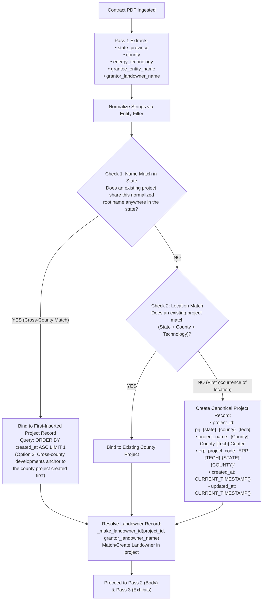
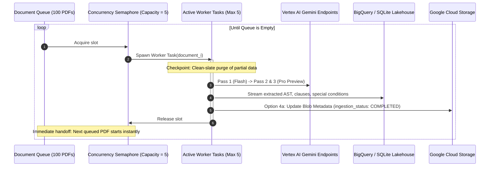
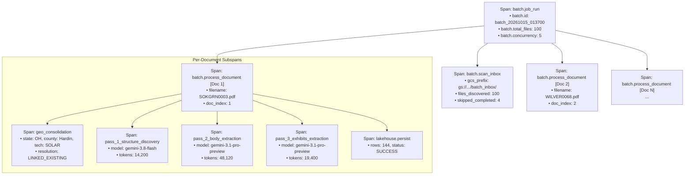

# Change Request CR-12: Historical Batch Ingestion, Autonomous Geo-Project Consolidation & Web Job Controller

* **CR ID:** `CR-012` (Historical Batch Ingestion, Autonomous Geo-Project Consolidation & Web Job Controller — `v0.12.0`)
* **Status:** Approved Architecture Specification (EGM Co-Design Fortified)
* **Parent Architecture:** [DESIGN_DOC.md](file:///usr/local/google/home/prasannaankem/Code/Invenergy/Design/DESIGN_DOC.md), [CR2_PROJECT_PORTFOLIO_HIERARCHY.md](file:///usr/local/google/home/prasannaankem/Code/Invenergy/Design/CR2_PROJECT_PORTFOLIO_HIERARCHY.md), [CR5_SEMANTIC_ZONE_MULTI_PASS_EXTRACTION.md](file:///usr/local/google/home/prasannaankem/Code/Invenergy/Design/CR5_SEMANTIC_ZONE_MULTI_PASS_EXTRACTION.md), [CR7_ENTERPRISE_PASSWORDLESS_AUTH.md](file:///usr/local/google/home/prasannaankem/Code/Invenergy/Design/CR7_ENTERPRISE_PASSWORDLESS_AUTH.md), [CR8_ENTERPRISE_OBSERVABILITY_AND_DISTRIBUTED_TRACING.md](file:///usr/local/google/home/prasannaankem/Code/Invenergy/Design/CR8_ENTERPRISE_OBSERVABILITY_AND_DISTRIBUTED_TRACING.md), [CR10_CONFIGURABLE_IDENTITY_GATEWAY.md](file:///usr/local/google/home/prasannaankem/Code/Invenergy/Design/CR10_CONFIGURABLE_IDENTITY_GATEWAY.md), [CR11_CONTRACT_VARIANCE_ENGINE_AND_REDLINE_STUDIO.md](file:///usr/local/google/home/prasannaankem/Code/Invenergy/Design/CR11_CONTRACT_VARIANCE_ENGINE_AND_REDLINE_STUDIO.md)
* **Confirmed Architectural Decisions:**
  1. **Pilot Scope & Input Topology:**
     Optimized to ingest an initial pilot of **100 historical contracts** sourced from a single flat Google Cloud Storage prefix (`gs://<bucket>/batch_inbox/*.pdf`). External document synchronization (e.g. from SharePoint or corporate drives into GCS) remains decoupled from the core ingestion pipeline.
  2. **Option 3 (Additive Project Timestamp): Location-Driven Consolidation & First-Inserted Anchor Rule:**
     Extracts location coordinates (`state_province`, `county`) and `energy_technology` during Pass 1 discovery. Contracts sharing `(State, County, Technology)` automatically consolidate into a single portfolio project. For multi-county developments, agreements matching an existing project name or entity anchor strictly to the project inserted first (ordered deterministically by `created_at ASC`), preventing cross-county fragmentation.
  3. **Deterministic Synthetic ERP Project Codes:**
     To maintain existing database constraints (`erp_project_code NOT NULL`) in SQLite and BigQuery without breaking migrations, auto-provisioned projects generate a canonical synthetic ERP code derived from technology and geography: `ERP-{TECH_ABBR}-{STATE}-{COUNTY}` (e.g. `ERP-WND-IL-MCLEAN`, `ERP-SOL-OH-HARDIN`, with fallback `ERP-{TECH_ABBR}-AUTO`). Operators can rebind official corporate Oracle codes post-ingestion.
  4. **Option B Sliding-Window Worker Pool (Continuous 5 Active Workers):**
     Eliminates idle wait time of rigid block barriers. Bounded semaphore governs exactly 5 concurrent contract workers. As soon as any individual agreement finishes, the next queued PDF starts immediately, capping simultaneous Vertex AI Gemini requests at $\le 10$ (2 concurrent passes per worker).
  5. **Option 3b: Dedicated Batch Dockerfile (`Dockerfile.batch`) & Decoupled Cloud Run Job (`contract-parser-batch`):**
     Decouples long-running batch ingestion (~75 minutes for 100 contracts) from serverless HTTP request timeouts (60 min maximum). The batch runner executes as an independent **Cloud Run Job** packaged in a dedicated container (`Dockerfile.batch`) with dedicated CPU/memory. For local development and test environments, an asynchronous in-process background runner executes the identical pipeline.
  6. **Option 1a: Dual-Engine BigQuery & SQLite State Tracking (Windowed Subquery Views):**
     Implements `batch_jobs` (run-level state, counts, duration, token metrics) and `batch_job_items` (per-document status, extracted project, latency, errors) in both Google BigQuery (`contract_intelligence` dataset) and local SQLite (`storage.py`). Provides BigQuery deduplicated views (`v_active_batch_*` via `QUALIFY`) and compatible SQLite views using subqueries with window functions.
  7. **Option 4a: Sub-Second GCS Object Metadata Pre-Flight Scanning:**
     Pre-flight bucket scanning (`POST /api/v1/batch/scan`) uses native GCS object metadata (`metadata = {"ingestion_status": "COMPLETED", "document_id": "..."}`) retrieved in `list_blobs` directory listings without downloading PDF bodies, enabling instantaneous zero-bandwidth status checks.
  8. **Clean-Slate Atomicity & Partial Processing Recovery:**
     If a document encounters a failure or is interrupted mid-pipeline, it is marked `FAILED` in `batch_job_items`. On re-run or retry, the engine purges any partial records in lakehouse tables for that document/item and re-executes the file from scratch from page 1, guaranteeing zero orphaned or half-extracted clauses.
  9. **Full-Lifecycle OpenTelemetry Tracing & Correlated Logging:**
     Hierarchical distributed trace structure (`batch.job_run` $\rightarrow$ `batch.process_document` $\rightarrow$ `pass_1/2/3`). Correlated JSON Cloud Logging using 6 discrete stages (`STAGE_SCAN`, `STAGE_GEO_RESOLVE`, `STAGE_PASS_START`, `STAGE_TOKEN_METRICS`, `STAGE_PERSIST`, `STAGE_ITEM_FAIL`, `STAGE_BATCH_SUMMARY`). Post-document `flush_telemetry()` ensures zero span loss.
  10. **Enterprise Role-Based Access Control (Admin-Only Mutations):**
      Batch triggering (`/api/v1/batch/launch`) and retries (`/api/v1/batch/retry/{job_id}`) strictly require `UserRole.ADMIN` (`require_admin`). Read-only users (`UserRole.VIEWER`) may inspect the dashboard and perform pre-flight scans. Job cancellation (`CANCELLED` status) is explicitly deferred for the initial release.
  11. **"Batch Ingestion Studio" Web Dashboard:**
      A dedicated workspace tab in the web application providing bucket pre-flight scanning, a single-click "Launch Batch Job" trigger, real-time progress KPI cards, live tabular feed, failure inspection drawers, and direct links to view parsed contracts in the viewer.
  12. **On-Demand Variance Analysis (CR-11 Decoupled):**
      Batch ingestion focuses strictly on structural AST decomposition, exhibit cataloging, landowner entity resolution, and special condition extraction into the core tables. Template variance and legal redline analysis remain on-demand in the Redline Studio.

---

## 1. Executive Summary & Problem Statement

Invenergy manages roughly 300 active renewable energy developments, with an average of 50 landowners per project, representing an archive of **~15,000 executed contracts**. While the platform currently provides an interactive split-pane UI for single-document ingestion and legal analysis, onboarding existing portfolios requires an automated historical backfill mechanism.

### Key Operational Challenges Addressed:
1. **Unorganized Flat Directories:** Historical archives are dumped into flat storage buckets without folder hierarchies or project metadata tags.
2. **Project Entity Sprawl:** Slight textual variations (e.g. *"Cedar Lantern Wind, LLC"* vs *"Cedar Lantern Phase 1"*) risk creating duplicate projects for the same physical development unless canonical location-driven consolidation is enforced.
3. **Serverless HTTP Timeouts:** Ingesting 100 contracts requires ~75 minutes of compute. Standard web requests time out after minutes, necessitating an asynchronous fire-and-forget job architecture.
4. **Vertex AI Quota Governance:** Uncontrolled concurrency triggers HTTP 429 (`ResourceExhausted`) errors. A continuous sliding-window pool of 5 workers balances high throughput with quota stability.
5. **Observability Across Long Runs:** Without correlated telemetry, operators cannot diagnose slow contracts, identify corrupt PDFs, or track token expenditure during massive backfills.

### 1.1 Architecture Trade-Offs & Option Selection Matrix

| Architectural Domain | Evaluated Options | Confirmed Selection | Technical Rationale |
| :--- | :--- | :--- | :--- |
| **Local SQLite State Tracking** | • **Option 1a: Windowed Subquery Views**<br/>• Option 1b: Mutable UPSERT on Conflict<br/>• Option 1c: In-Memory Dict | **Option 1a: Windowed Subquery Views** | Guarantees identical append-only data model and query semantics across SQLite and BigQuery without divergence; preserves test suite integrity. |
| **First-Inserted Anchor Tie-Breaking** | • **Option 3: Additive `created_at` Column**<br/>• Option 3b: `updated_at ASC` Fallback<br/>• Option 3c: Separate Anchors Table | **Option 3: Additive `created_at` Column** | Adding `created_at` to `projects` and `ProjectRow` provides deterministic founding-project ordering for multi-county wind/solar assets. |
| **Batch Job Container Packaging** | • **Option 3b: Dedicated `Dockerfile.batch`**<br/>• Option 3b-alt: Shared Image with CLI Override | **Option 3b: Dedicated `Dockerfile.batch`** | Isolates batch runner entrypoint and environment dependencies from the Uvicorn web server, ensuring clean serverless Cloud Run Job deployment. |
| **Pre-Flight GCS Inbox Scan** | • **Option 4a: GCS Custom Object Metadata**<br/>• Option 4b: DB Query by GCS URI<br/>• Option 4c: Full PDF Download & SHA-256 | **Option 4a: GCS Custom Object Metadata** | Sub-second directory inspection via `blob.metadata['ingestion_status']` with zero byte transfer overhead or PDF downloads. |

---

## 2. End-to-End System Architecture

```mermaid
flowchart TD
    subgraph StorageLayer["1. Source Storage & Triggers"]
        GCS["Cloud Storage Flat Inbox<br/>gs://<bucket>/batch_inbox/*.pdf<br/>(Option 4a: Blob Metadata: ingestion_status)"]
        WebUI["Web UI: Batch Ingestion Studio<br/>[Launch Batch Job Button - Admin Only]"]
        CLI["CLI / gcloud run jobs execute"]
    end

    subgraph Orchestration["2. Job Orchestrator & State Tracking"]
        CRService["Cloud Run Web Service<br/>(POST /api/v1/batch/launch)"]
        CRJob["Cloud Run Job: contract-parser-batch<br/>(Option 3b: Dockerfile.batch, Full CPU, 2h Timeout)"]
        LocalRunner["Local Dev Background Runner<br/>(asyncio / ThreadPool fallback)"]
        StateDB[("Option 1a: BigQuery / SQLite State<br/>• batch_jobs<br/>• batch_job_items")]
    end

    subgraph WorkerPool["3. Sliding-Window Worker Pool (5 Active Workers)"]
        W1["Worker Slot 1"]
        W2["Worker Slot 2"]
        W3["Worker Slot 3"]
        W4["Worker Slot 4"]
        W5["Worker Slot 5"]
    end

    subgraph Pipeline["4. Extraction & Canonical Resolution"]
        Pass1["Pass 1: Discovery & Geo Metadata<br/>(Gemini 3.8 Flash)"]
        GeoMatch{"Geo Resolution Gate<br/>1. Root Name Anchor Match?<br/>2. (State + County + Tech) Match?"}
        Pass23["Passes 2 & 3: Concurrent Body & Exhibits<br/>(Gemini 3.1 Pro Preview)"]
        Lakehouse[("BigQuery / SQLite Lakehouse<br/>Core Tables + Deduplicated Views")]
    end

    subgraph Telemetry["5. Observability (CR-8 Foundation)"]
        OTel["OpenTelemetry TracerProvider"]
        CloudTrace[("Google Cloud Trace<br/>Hierarchical Spans")]
        CloudLogging[("Google Cloud Logging<br/>Structured Stage JSON")]
    end

    WebUI -->|Trigger Job (Admin)| CRService
    CLI -->|Direct Execute| CRJob
    CRService -->|Cloud Run Admin API| CRJob
    CRService -.->|Local Dev Fallback| LocalRunner
    CRService <-->|Poll Status| StateDB
    CRJob -->|Discover Files & Metadata| GCS
    CRJob <-->|Update Progress| StateDB

    CRJob --> W1 & W2 & W3 & W4 & W5
    LocalRunner --> W1 & W2 & W3 & W4 & W5
    W1 & W2 & W3 & W4 & W5 --> Pass1
    Pass1 --> GeoMatch
    GeoMatch --> Pass23
    Pass23 --> Lakehouse
    Pass23 -->|Option 4a: Tag Blob Metadata: COMPLETED| GCS

    W1 & W2 & W3 & W4 & W5 -.->|Traces & Metrics| OTel
    OTel --> CloudTrace
    OTel --> CloudLogging
```

---

## 3. Location-Driven Consolidation & First-Inserted Anchor Algorithm

When contracts are processed from a flat directory, the engine determines project ownership using a deterministic resolution cascade:

### The Mathematical Identity Key:
$$\text{GeoKey} = \text{Norm}(\text{State}) + \text{"\_"} + \text{Norm}(\text{County}) + \text{"\_"} + \text{EnergyTechnology}$$

### The String Normalization Protocol:
To eliminate legal entity sprawl, string inputs (`grantee_entity_name`, `project_name`) are processed through a deterministic normalization filter:
1. **Case Normalization:** Convert string to uppercase.
2. **Corporate & Phase Token Stripping (Regex Word Boundaries):**
   ```python
   ENTITY_CLEANUP_REGEX = re.compile(
       r"\b(LLC|L\.L\.C\.|CORP|CORPORATION|INC|INCORPORATED|CO|COMPANY|HOLDINGS|PHASE\s*(?:[IVX\d]+))\b",
       re.IGNORECASE,
   )
   ```
3. **Punctuation Stripping:** Remove commas, periods, hyphens, underscores, and quotes (`re.sub(r"[,.\-_'\"]", " ", text)`).
4. **Whitespace Collapsing:** `re.sub(r"\s+", " ", text).strip()`.

### The Resolution Protocol:


#### Deterministic Invariants:
1. **Option 3 First-Inserted Anchor Stability via `created_at`:**
   When a wind project spans multiple counties (e.g. McLean and Livingston), the first lease processed establishes the master project record (e.g. `prj_il_mclean_wind`, with `created_at = T0`). When subsequent agreements arrive citing *"Cedar Lantern Wind Energy Center LLC"* located in adjacent Livingston County, Check 1 identifies the existing project in the state and anchors strictly to the project with the earliest `created_at` timestamp. This prevents arbitrary fragmentation.
2. **Deterministic Synthetic ERP Codes (No Nulls):**
   Existing database schemas in SQLite and BigQuery require `erp_project_code NOT NULL`. Rather than executing a breaking schema change across production environments, the engine assigns a structured synthetic code:
   $$\text{erp\_project\_code} = \text{"ERP-" + TECH\_CODE + "-" + STATE + "-" + COUNTY}$$
   * `ONSHORE_WIND` $\rightarrow$ `ERP-WND-IL-MCLEAN`
   * `SOLAR` $\rightarrow$ `ERP-SOL-OH-HARDIN`
   * `STORAGE` $\rightarrow$ `ERP-STR-TX-PECOS`
   * `TRANSMISSION` $\rightarrow$ `ERP-TRN-KS-FINNEY`
   * Fallback: `ERP-{TECH_CODE}-AUTO`
   This satisfies constraints, unblocks batch runs, and flags the record for corporate accounting review.
3. **Missing Geolocation Fallback:**
   If Pass 1 fails to identify a county or state from the preamble, the engine assigns `state_province = "US"`, `county = "REGIONAL"`, creates or binds to `prj_us_regional_{tech}`, and tags the item in `batch_job_items` with `error_message = "WARNING: Geolocation unresolved; assigned to regional pool"`.

### Pass 1 Schema Additions (`ContractStructureIndex`):
The Pass 1 Pydantic model in `contract_parser/schemas.py` is extended with:
```python
class ContractStructureIndex(BaseModel):
    ...
    state_province: str | None = Field(default=None, description="Two-letter US state code or province (e.g. 'IL', 'OH')")
    county: str | None = Field(default=None, description="County or parish jurisdiction (e.g. 'McLean', 'Hardin')")
    energy_technology: EnergyTechnology = Field(
        default=EnergyTechnology.ONSHORE_WIND,
        description="ONSHORE_WIND, SOLAR, STORAGE, TRANSMISSION, or GEOTHERMAL",
    )
```

---

## 4. Concurrency Model: Option B Sliding-Window Worker Pool

The batch engine enforces a continuous sliding window using an asynchronous bounded semaphore:



### Performance Characteristics:
* **Target Concurrency:** Exactly 5 active contract extractions at any time.
* **Throughput:** An average 35-page lease completes in 210 seconds. With 5 workers, the pipeline delivers **~1.43 completed contracts per minute**.
* **Total Run Time:** 100 contracts complete in **~70–75 minutes**.
* **Rate-Limit Cushion:** 5 concurrent contracts generate peak ~10 requests/minute and ~250k TPM, safely below Vertex AI Enterprise quotas (60–300 RPM).
* **Fault Isolation & Clean-Slate Retries:** Corrupt or failed PDFs fail fast, record the exact error to `batch_job_items`, release their semaphore slot, and allow the next document to proceed. On retry, any incomplete records in the lakehouse are deleted before re-extracting from page 1.

---

## 5. Dual-Engine Data Model & Schema DDL

Two state tracking tables are maintained in both Google BigQuery (`contract_intelligence` dataset) and local SQLite (`storage.py`).

### Table 1: `batch_jobs` (Run-Level State)

#### BigQuery DDL:
```sql
CREATE TABLE IF NOT EXISTS `contract_intelligence.batch_jobs` (
    job_id STRING NOT NULL,
    gcs_prefix STRING NOT NULL,
    total_files INT64 NOT NULL,
    processed_files INT64 NOT NULL,
    success_count INT64 NOT NULL,
    failure_count INT64 NOT NULL,
    status STRING NOT NULL, -- 'PENDING', 'RUNNING', 'COMPLETED', 'FAILED'
    started_at TIMESTAMP NOT NULL,
    completed_at TIMESTAMP,
    total_tokens_consumed INT64 NOT NULL,
    prompt_tokens_consumed INT64 NOT NULL,
    completion_tokens_consumed INT64 NOT NULL,
    triggered_by STRING,
    error_summary STRING,
    updated_at TIMESTAMP NOT NULL
)
PARTITION BY DATE(started_at)
CLUSTER BY job_id, status;

CREATE OR REPLACE VIEW `contract_intelligence.v_active_batch_jobs` AS
SELECT *
FROM `contract_intelligence.batch_jobs`
QUALIFY ROW_NUMBER() OVER (PARTITION BY job_id ORDER BY updated_at DESC) = 1;
```

#### Option 1a: SQLite DDL (Local Dev & Unit Tests):
```sql
CREATE TABLE IF NOT EXISTS batch_jobs (
    job_id TEXT NOT NULL,
    gcs_prefix TEXT NOT NULL,
    total_files INTEGER NOT NULL,
    processed_files INTEGER NOT NULL,
    success_count INTEGER NOT NULL,
    failure_count INTEGER NOT NULL,
    status TEXT NOT NULL,
    started_at TEXT NOT NULL,
    completed_at TEXT,
    total_tokens_consumed INTEGER NOT NULL DEFAULT 0,
    prompt_tokens_consumed INTEGER NOT NULL DEFAULT 0,
    completion_tokens_consumed INTEGER NOT NULL DEFAULT 0,
    triggered_by TEXT,
    error_summary TEXT,
    updated_at TEXT NOT NULL
);

CREATE VIEW IF NOT EXISTS v_active_batch_jobs AS
SELECT * FROM (
    SELECT *, ROW_NUMBER() OVER (PARTITION BY job_id ORDER BY updated_at DESC) AS rn
    FROM batch_jobs
) WHERE rn = 1;
```

---

### Table 2: `batch_job_items` (Document-Level State)

#### BigQuery DDL:
```sql
CREATE TABLE IF NOT EXISTS `contract_intelligence.batch_job_items` (
    item_id STRING NOT NULL,
    job_id STRING NOT NULL,
    gcs_uri STRING NOT NULL,
    filename STRING NOT NULL,
    document_id STRING, -- Populated upon successful extraction
    project_id STRING,  -- Inferred or matched project
    landowner_id STRING,
    status STRING NOT NULL, -- 'QUEUED', 'PROCESSING', 'COMPLETED', 'FAILED'
    state_province STRING,
    county STRING,
    energy_technology STRING,
    clause_count INT64,
    special_conditions_count INT64,
    duration_seconds FLOAT64,
    token_usage_total INT64,
    error_message STRING,
    started_at TIMESTAMP,
    completed_at TIMESTAMP,
    updated_at TIMESTAMP NOT NULL
)
PARTITION BY DATE(updated_at)
CLUSTER BY job_id, status, document_id;

CREATE OR REPLACE VIEW `contract_intelligence.v_active_batch_job_items` AS
SELECT *
FROM `contract_intelligence.batch_job_items`
QUALIFY ROW_NUMBER() OVER (PARTITION BY item_id ORDER BY updated_at DESC) = 1;
```

#### Option 1a: SQLite DDL (Local Dev & Unit Tests):
```sql
CREATE TABLE IF NOT EXISTS batch_job_items (
    item_id TEXT NOT NULL,
    job_id TEXT NOT NULL,
    gcs_uri TEXT NOT NULL,
    filename TEXT NOT NULL,
    document_id TEXT,
    project_id TEXT,
    landowner_id TEXT,
    status TEXT NOT NULL,
    state_province TEXT,
    county TEXT,
    energy_technology TEXT,
    clause_count INTEGER,
    special_conditions_count INTEGER,
    duration_seconds REAL,
    token_usage_total INTEGER,
    error_message TEXT,
    started_at TEXT,
    completed_at TEXT,
    updated_at TEXT NOT NULL
);

CREATE VIEW IF NOT EXISTS v_active_batch_job_items AS
SELECT * FROM (
    SELECT *, ROW_NUMBER() OVER (PARTITION BY item_id ORDER BY updated_at DESC) AS rn
    FROM batch_job_items
) WHERE rn = 1;
```

---

### Option 3: Additive Schema Enhancement to `projects` Table
To support the "first-inserted anchor" rule without breaking existing projects, `created_at` is added as an additive column to [ProjectRow](file:///usr/local/google/home/prasannaankem/Code/Invenergy/contract_parser/schemas.py#L169-L195):
```python
class ProjectRow(BaseModel):
    ...
    created_at: str = Field(default_factory=utc_now_iso, description="UTC timestamp of project record creation")
    updated_at: str = Field(default_factory=utc_now_iso, description="UTC timestamp of latest project update")
```

#### Migration DDL:
```sql
-- SQLite
ALTER TABLE projects ADD COLUMN created_at TEXT;
UPDATE projects SET created_at = updated_at WHERE created_at IS NULL;

-- BigQuery
ALTER TABLE `contract_intelligence.projects` ADD COLUMN IF NOT EXISTS created_at TIMESTAMP;
UPDATE `contract_intelligence.projects` SET created_at = updated_at WHERE created_at IS NULL;
```

---

## 6. Observability, Distributed Tracing & Logging Architecture

CR-12 expands upon CR-8's OpenTelemetry foundation with specialized batch telemetry:



### 1. Six Discrete Cloud Logging Stages:
All batch logs emit structured JSON adhering to `CloudLoggingJsonFormatter`, tagged with `jsonPayload.stage`:
* `STAGE_SCAN`: Discovered PDF count, skipped existing documents via GCS metadata.
* `STAGE_GEO_RESOLVE`: Location matching decisions and project linking rationales.
* `STAGE_PASS_START`: Pass initiation with model name, worker ID, and page range.
* `STAGE_TOKEN_METRICS`: Prompt/output token consumption and pass execution latency.
* `STAGE_PERSIST`: Row counts streamed to BigQuery and GCS CSV export paths.
* `STAGE_ITEM_FAIL`: Exact exception types, stack traces, and unparseable document alerts.
* `STAGE_BATCH_SUMMARY`: Final job-level duration, average sec/doc, token spend, and success rate.

### 2. Option 4a: GCS Object Metadata Tagging on Completion:
Upon successful persistence to the Lakehouse, the worker stamps custom metadata onto the source GCS blob:
```python
blob.metadata = {
    "ingestion_status": "COMPLETED",
    "document_id": document_id,
    "job_id": job_id,
    "completed_at": utc_now_iso(),
}
blob.patch()
```

---

## 7. REST API & Execution Controller Interface

### REST API Endpoints (Cloud Run Web Service):

| Method | Endpoint | RBAC Guard | Description | Request / Response Payload |
| :--- | :--- | :--- | :--- | :--- |
| `POST` | `/api/v1/batch/scan` | `Viewer` / `Admin` | Option 4a: Scans GCS prefix using object metadata; returns file metrics. | **Req:** `{ "gcs_prefix": "gs://bucket/batch_inbox/" }`<br/>**Res:** `{ "total_files": 100, "valid_pdfs": 100, "already_ingested": 12 }` |
| `POST` | `/api/v1/batch/launch` | **`Admin Only`** | Creates job record and launches async batch execution. | **Req:** `{ "gcs_prefix": "gs://...", "concurrency": 5 }`<br/>**Res:** `{ "job_id": "batch_20261015_013700", "status": "PENDING" }` |
| `GET` | `/api/v1/batch/jobs/{job_id}` | `Viewer` / `Admin` | Returns live status, progress counters, and document items. | **Res:** `{ "job_id": "...", "processed": 42, "total": 100, "status": "RUNNING", "items": [...] }` |
| `GET` | `/api/v1/batch/jobs` | `Viewer` / `Admin` | Lists historical batch execution runs. | **Res:** `[ { "job_id": "...", "total": 100, "status": "COMPLETED", ... } ]` |
| `POST` | `/api/v1/batch/retry/{job_id}` | **`Admin Only`** | Purges partial records and re-queues only failed items. | **Res:** `{ "re_queued_count": 2, "status": "RUNNING" }` |

### Cloud Run Job Invocation Mechanics:
When `POST /api/v1/batch/launch` is invoked:
1. **Production (GCP):**
   The web service initializes the Google Cloud Run v2 Client (`google.cloud.run_v2.JobsClient`) and executes:
   ```python
   client = google.cloud.run_v2.JobsClient()
   request = google.cloud.run_v2.RunJobRequest(
       name=f"projects/{GCP_PROJECT}/locations/{REGION}/jobs/contract-parser-batch",
       overrides=google.cloud.run_v2.RunJobRequest.Overrides(
           container_overrides=[
               google.cloud.run_v2.RunJobRequest.Overrides.ContainerOverride(
                   args=[
                       "--job-id", job_id,
                       "--gcs-prefix", gcs_prefix,
                       "--concurrency", str(concurrency),
                   ]
               )
           ]
       ),
   )
   client.run_job(request=request)
   ```
2. **Local Development Fallback (`USE_LOCAL_BATCH_RUNNER=true`):**
   If Cloud Run credentials are not present or local runner is toggled, the FastAPI app spawns the batch execution as an in-process asynchronous task (`asyncio.create_task(run_local_batch_pipeline(...))`), updating local SQLite tables identically.

---

## 8. Web UI Specification: "Batch Ingestion Studio"

A dedicated workspace tab `#batch-studio-pane` is added to the top-level navigation, with mutation controls enabled exclusively for `Admin` users:

```
+--------------------------------------------------------------------------------------------------+
| 📁 BATCH INGESTION STUDIO                                     [Active Job: batch_20261015_013700]|
+--------------------------------------------------------------------------------------------------+
| Source GCS Prefix: [ gs://pr-tftest-contract-intelligence/batch_inbox/     ] [ 🔍 Scan Bucket ]  |
| Worker Concurrency: [ 5 Workers (Sliding Window) ▼ ]     Auto-Consolidate: [✓] Geo (State+County) |
|                                                                                                  |
| [ ▶ LAUNCH BATCH JOB (Admin) ]                                           [ 🔄 Refresh Status ]   |
+--------------------------------------------------------------------------------------------------+
| OVERALL PROGRESS: [=========================>                      ] 45% (45 / 100 Documents)    |
| ⏱ Elapsed: 00:31:12 | ⏳ Est. Remaining: 00:38:10 | ⚡ Active Workers: 5 | ❌ Failed: 1           |
+--------------------------------------------------------------------------------------------------+
| SUMMARY KPI CARDS:                                                                               |
| [ Total Tokens: 4.82M ]   [ Clauses Extracted: 4,120 ]   [ Special Conditions (DND): 384 ]       |
+--------------------------------------------------------------------------------------------------+
| LIVE INGESTION FEED                                                                              |
| Status      | Filename                  | Inferred Project         | County, State | Clauses | Act |
|-------------+---------------------------+--------------------------+---------------+---------+-----|
| COMPLETED   | SOKGRN0003_SolarLease.pdf | Sun Ridge Solar          | Hardin, OH    | 127     | [👁] |
| COMPLETED   | WILVER0068_WindEasement   | Cedar Lantern Wind       | McLean, IL    | 98      | [👁] |
| PROCESSING  | WMIEAT0018_WindEasement   | Cedar Lantern Wind       | McLean, IL    | --      | [⏳] |
| PROCESSING  | PPA_Interconnect_Doc04    | Blue Meridian HVDC       | Finney, KS    | --      | [⏳] |
| QUEUED      | LandLease_Parcel09.pdf    | (Pending Discovery)      | --            | --      | [--] |
| FAILED      | Corrupt_Scan_1998.pdf     | --                       | --            | 0       | [!] |
|   ↳ Reason: PDFSyntaxError: EOF marker not found (File corrupted during transfer)                |
+--------------------------------------------------------------------------------------------------+
```

### UI Features:
1. **Direct Viewer Drill-Down:** Clicking `[👁]` on any completed row opens the contract directly in the existing split-pane PDF & AST review viewer.
2. **Expandable Error Drawer:** Failed rows highlight with an amber/red border and display the underlying failure reason.
3. **One-Click Retry (Admin Only):** A `[ Retry Failed Files ]` button restarts failed items without re-ingesting completed contracts.

---

## 9. Option 3b: Containerization, IAM Security & Customer Deployment Guide

### Dedicated Container: `Dockerfile.batch`
To cleanly separate serverless web serving from compute-intensive batch execution, a dedicated container image is built:

```dockerfile
FROM python:3.12-slim

ENV PYTHONDONTWRITEBYTECODE=1 \
    PYTHONUNBUFFERED=1 \
    LOCAL_DATA_DIR=/tmp/data

WORKDIR /app

COPY pyproject.toml .
COPY Design/ Design/
COPY contract_parser/ contract_parser/
COPY samples/ samples/

RUN pip install --no-cache-dir .
RUN mkdir -p /tmp/data

ENTRYPOINT ["python", "-m", "contract_parser.batch"]
```

### Service Account & IAM Security Configuration:

#### 1. Batch Job Runtime Service Account (`contract-parser-batch-sa`):
* `roles/storage.objectAdmin`: Read PDF blobs, read/write custom metadata (Option 4a), write CSV exports.
* `roles/bigquery.dataEditor` & `roles/bigquery.jobUser`: Stream rows to Lakehouse and batch tracking tables.
* `roles/aiplatform.user`: Call Vertex AI Gemini 3.8 Flash and Gemini 3.1 Pro Preview endpoints.
* `roles/cloudtrace.agent`: Export OpenTelemetry spans to Google Cloud Trace.
* `roles/logging.logWriter`: Emit structured JSON logs to Google Cloud Logging.

#### 2. Web Service Service Account (`contract-parser-sa`):
* `roles/run.developer` on the Cloud Run Job `contract-parser-batch`.
* `roles/iam.serviceAccountUser` on `contract-parser-batch-sa`.

### Infrastructure Provisioning Commands (`scripts/setup_gcp_environment.sh` & `README.md`):
```bash
# 1. Build and push the dedicated batch container (Option 3b)
gcloud builds submit --tag "gcr.io/${PROJECT_ID}/contract-parser-batch:v0.12.0" -f Dockerfile.batch .

# 2. Create the Cloud Run Job
gcloud run jobs create contract-parser-batch \
    --image="gcr.io/${PROJECT_ID}/contract-parser-batch:v0.12.0" \
    --region="${REGION}" \
    --tasks=1 \
    --cpu=2 \
    --memory=4Gi \
    --task-timeout=7200s \
    --service-account="contract-parser-batch-sa@${PROJECT_ID}.iam.gserviceaccount.com" \
    --set-env-vars="PROJECT_ID=${PROJECT_ID},BIGQUERY_DATASET=contract_intelligence,AUTH_ENABLED=true"

# 3. Grant Web Service Permission to Trigger the Job
gcloud run jobs add-iam-policy-binding contract-parser-batch \
    --region="${REGION}" \
    --member="serviceAccount:contract-parser-sa@${PROJECT_ID}.iam.gserviceaccount.com" \
    --role="roles/run.invoker"
```

---

## 10. Verification & Acceptance Criteria (Gherkin Scenarios)

### Scenario 1: Flat Bucket Scan & Asynchronous Job Launch (Admin Gated)
* **Given** a flat GCS directory `gs://<bucket>/batch_inbox/` containing 100 valid contract PDFs.
* **When** an Admin user clicks "Launch Batch Job" in the Batch Ingestion Studio.
* **Then** the backend creates a `batch_jobs` record with `total_files = 100` and `status = 'PENDING'`.
* **And** immediately returns HTTP 202 with `job_id = "batch_YYYYMMDD_HHMMSS"` without blocking the browser.
* **And** the Cloud Run Job initiates execution in the background via Option 3b.

### Scenario 2: Location-Driven Project Auto-Provisioning with Synthetic ERP Code
* **Given** an agreement whose preamble states *"located in Hardin County, State of Ohio"* for a solar installation.
* **When** the batch engine processes Pass 1 discovery.
* **Then** the engine checks `projects` for an existing Ohio solar project in Hardin County.
* **And** if absent, creates `prj_oh_hardin_solar` with name *"Hardin County Solar Center"* and `erp_project_code = "ERP-SOL-OH-HARDIN"`.
* **And** populates `created_at` (Option 3) and `updated_at` with the current UTC timestamp.
* **And** associates the document and extracted landowners with that new project.

### Scenario 3: Cross-County First-Inserted Anchor Consolidation (Option 3)
* **Given** an existing project `prj_il_mclean_wind` created from a McLean County lease at `T0`.
* **When** a subsequent lease arrives with grantee *"Cedar Lantern Wind Energy Center LLC"* located in adjacent Livingston County.
* **Then** the engine matches the normalized grantee name to the McLean project.
* **And** binds the Livingston lease to `prj_il_mclean_wind` via the earliest `created_at` timestamp instead of creating an isolated Livingston project.
* **And** records a `cross_county_anchor_bound` OpenTelemetry span event.

### Scenario 4: Option B Sliding-Window Concurrency Cap
* **Given** a batch queue of 100 contracts.
* **When** the job worker starts execution.
* **Then** exactly 5 active contract worker tasks run concurrently.
* **And** when any single contract finishes, the next contract from the queue immediately begins on that worker slot.
* **And** total concurrent Gemini requests never exceed 10.

### Scenario 5: Fault Tolerance, Clean-Slate Purge & Checkpoint Idempotency (Option 4a)
* **Given** a batch containing 98 valid PDFs and 2 corrupted files.
* **When** the batch execution completes.
* **Then** the 2 corrupt files are marked `status = 'FAILED'` in `batch_job_items` with error traces.
* **And** the remaining 98 contracts are fully persisted in BigQuery and marked with GCS custom metadata `ingestion_status = 'COMPLETED'` (Option 4a).
* **When** the operator triggers `/api/v1/batch/retry/{job_id}`.
* **Then** the engine purges any partial records for the 2 failed files and re-processes them from page 1 without touching the 98 completed contracts.

### Scenario 6: OpenTelemetry Distributed Tracing & Logging Correlation
* **Given** an executing batch job.
* **When** checking Google Cloud Trace.
* **Then** each document execution appears as a child span linked to root `batch.job_run`.
* **And** all logs in Google Cloud Logging contain `logging.googleapis.com/trace`, `batch.id`, and stage tags (`STAGE_GEO_RESOLVE`, `STAGE_TOKEN_METRICS`).
* **And** `flush_telemetry()` executes after every document completion.
