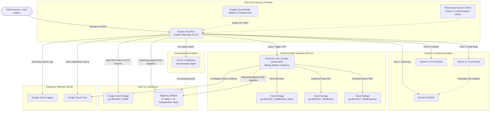

# Invenergy Contract Intelligence & Subcontractor DND Platform

An enterprise-grade, Gemini-first hierarchical contract parsing, extraction, and subcontractor clearance platform. The system ingests complex renewable energy land leases, easement agreements, and power purchase agreements (PPAs), decomposes them into structural AST nodes, extracts actionable landowner special conditions, and stages records into a dual-store lakehouse (Cloud Storage + BigQuery).

---

## 1. System Architecture



---

## 2. Repository Layout

```
.
├── contract_parser/            # Core Application Source Code
│   ├── app.py                  # FastAPI Application, Routes & Static HTML Serving
│   ├── auth.py                 # Identity Platform / Firebase Auth & RBAC
│   ├── ask_agent.py            # BigQuery Data Analytics Agent Client & Proxy
│   ├── batch.py                # Historical Batch Ingestion & Autonomous Consolidation (CR-12)
│   ├── bundle_assembler.py     # AST Bundle Assembler & Signature Quarantine
│   ├── config.py               # Centralized Pipeline Configuration & Settings
│   ├── gemini_parser.py        # 3-Pass Gemini Multi-Pass Extraction Engine
│   ├── schemas.py              # Pydantic Schemas, AST Nodes & Enums
│   ├── storage.py              # Lakehouse Persistence (SQLite, GCS, BigQuery 14-Table Model)
│   ├── variance_engine.py      # Contract Variance, Redline Myers Diff & Risk Scoring (CR-11)
│   ├── static/                 # Single-Page Frontend Workspace & Workbench HTML
│   │   ├── index.html          # Main Contract Intelligence & Batch Studio UI
│   │   └── template_studio.html # Regional Template Studio Workbench (CR-9)
│   └── telemetry/              # OpenTelemetry Tracing & Cloud Logging (CR-8)
│       ├── logging_formatter.py # Cloud Logging Single-Line Structured JSON Formatter
│       ├── tracing.py          # TracerProvider & CloudTraceSpanExporter Setup
│       └── thread_propagation.py # TracedThreadPoolExecutor Context Propagation
├── scripts/
│   ├── setup_gcp_environment.sh # Automated GCP Infrastructure Provisioning Script
│   ├── deploy_cloud_run.sh      # Cloud Run Web Service & Cloud Run Job Deployment Script
│   ├── setup_local_dev.sh       # Local Developer Environment Bootstrapping Script
│   ├── cleanup_environment.sh   # Lakehouse & Cloud Storage Cleanup Utility
│   ├── README.md                # Automation Scripts Documentation Guide
│   └── sql/
│       ├── 01_create_tables.sql      # BigQuery 14-Table DDL with Partitioning & Clustering
│       ├── 02_create_views.sql       # Analytical Deduplication Views (15 Views)
│       └── 03_seed_erp_projects.sql  # Initial ERP Portfolio Projects Seed
├── tests/                      # Pytest Unit & Integration Test Suites
├── Dockerfile                  # Web Service Production Container Specification
├── Dockerfile.batch            # Standalone Cloud Run Job Batch Runner Specification
├── pyproject.toml              # Dependencies & Package Metadata
├── .env.example                # Runtime Environment Variables Template
└── Changelog.md                # Version History & Release Notes
```

---

## 3. Prerequisites

Before deploying to Sophia's GCP project, ensure the following are available:

1. **Google Cloud Project** with active billing enabled.
2. **Google Cloud SDK (`gcloud` and `bq` CLI tools)** installed and authenticated:
   ```bash
   gcloud auth login
   gcloud auth application-default login
   ```
3. **IAM Permissions:** The user or deployment pipeline running the provisioning scripts must hold:
   - `roles/resourcemanager.projectIamAdmin` (or `roles/owner`) to bind service account roles.
   - `roles/serviceusage.serviceUsageAdmin` to enable Google Cloud APIs.
   - `roles/storage.admin` to create Cloud Storage buckets.
   - `roles/bigquery.admin` to create datasets, tables, and views.
   - `roles/run.admin` and `roles/iam.serviceAccountUser` to deploy Cloud Run services.

---

## 4. Quick Start: Automated GCP Infrastructure Setup

Run the automated setup script to enable APIs, create the GCS bucket, build BigQuery tables/views, and configure the runtime service account in a single step:

```bash
# 1. Set target GCP Project and Region
export PROJECT_ID="your-target-project-id"
export REGION="us-central1"

# 2. Execute automated setup script
chmod +x ./scripts/setup_gcp_environment.sh
./scripts/setup_gcp_environment.sh
```

### What This Script Does:
1. **Enables 9 GCP APIs:** Cloud Run, Cloud Build, Artifact Registry, Vertex AI (`aiplatform`), BigQuery, Cloud Storage, Identity Toolkit, Cloud Trace, and Cloud Logging.
2. **Provisions Storage Bucket:** Creates `gs://${PROJECT_ID}-contract-intelligence` with Uniform Bucket-Level Access.
3. **Provisions BigQuery Lakehouse:** Creates dataset `contract_intelligence` in the specified region and runs:
   - `scripts/sql/01_create_tables.sql`: Creates 14 tables with clustering and partitioning.
   - `scripts/sql/02_create_views.sql`: Creates 15 analytical views with `QUALIFY ROW_NUMBER() = 1` active-state deduplication.
   - `scripts/sql/03_seed_erp_projects.sql`: Populates baseline renewable energy development assets.
4. **Provisions Runtime Service Account:** Creates `contract-parser-sa@${PROJECT_ID}.iam.gserviceaccount.com` and binds the 7 least-privilege roles:
   - `roles/bigquery.dataEditor`
   - `roles/bigquery.jobUser`
   - `roles/storage.objectAdmin`
   - `roles/aiplatform.user`
   - `roles/cloudtrace.agent`
   - `roles/logging.logWriter`
   - `roles/run.developer` (invokes Cloud Run Jobs for asynchronous batch processing)

---

## 5. Manual Step-by-Step GCP Setup

For enterprise DevOps teams requiring manual control over each step:

### Step 5.1: Enable APIs
```bash
gcloud services enable \
    run.googleapis.com \
    cloudbuild.googleapis.com \
    artifactregistry.googleapis.com \
    aiplatform.googleapis.com \
    bigquery.googleapis.com \
    storage.googleapis.com \
    identitytoolkit.googleapis.com \
    cloudtrace.googleapis.com \
    logging.googleapis.com \
    --project="${PROJECT_ID}"
```

### Step 5.2: Create Cloud Storage Bucket
```bash
gcloud storage buckets create "gs://${PROJECT_ID}-contract-intelligence" \
    --project="${PROJECT_ID}" \
    --location="${REGION}" \
    --uniform-bucket-level-access
```

### Step 5.3: Create BigQuery Dataset & Run SQL DDL
```bash
# Create dataset
bq --location="${REGION}" mk \
    --project_id="${PROJECT_ID}" \
    --dataset \
    --description="Invenergy Contract Intelligence Lakehouse" \
    contract_intelligence

# Run DDL scripts
bq query --use_legacy_sql=false --project_id="${PROJECT_ID}" < scripts/sql/01_create_tables.sql
bq query --use_legacy_sql=false --project_id="${PROJECT_ID}" < scripts/sql/02_create_views.sql
bq query --use_legacy_sql=false --project_id="${PROJECT_ID}" < scripts/sql/03_seed_erp_projects.sql
```

### Step 5.4: Create Runtime Service Account & Bind Roles
```bash
SA_NAME="contract-parser-sa"
SA_EMAIL="${SA_NAME}@${PROJECT_ID}.iam.gserviceaccount.com"

gcloud iam service-accounts create "${SA_NAME}" \
    --project="${PROJECT_ID}" \
    --display-name="Contract Intelligence Runtime SA"

ROLES=(
    "roles/bigquery.dataEditor"
    "roles/bigquery.jobUser"
    "roles/storage.objectAdmin"
    "roles/aiplatform.user"
    "roles/cloudtrace.agent"
    "roles/logging.logWriter"
    "roles/run.developer"
)

for role in "${ROLES[@]}"; do
    gcloud projects add-iam-policy-binding "${PROJECT_ID}" \
        --member="serviceAccount:${SA_EMAIL}" \
        --role="${role}" \
        --condition=None
done
```

---

## 6. BigQuery Conversational Data Analytics Agent Setup (CR-4)

The platform includes a conversational BigQuery Data Agent tab that allows legal analysts and construction foremen to query the contract lakehouse in natural language.

### Creating the Agent in BigQuery Studio:
1. Open the [Google Cloud Console > BigQuery](https://console.cloud.google.com/bigquery).
2. In the BigQuery Studio navigation menu, select **Data Agents** (or **Gemini Data Analytics Agents**).
3. Click **Create Data Agent**.
4. Configure the agent settings:
   - **Agent Name:** `contract-intelligence-agent`
   - **Region:** `us` (or matching multi-region / region)
   - **Grounded Data Source:** Select BigQuery dataset `contract_intelligence`.
   - **Selected Views:** Select `v_contract_intelligence_mart`, `v_active_documents`, and `v_active_special_conditions`.
   - **System Instructions:** 
     > "You are an expert contract intelligence assistant for renewable energy projects. You help project managers and legal teams analyze land leases, special conditions, and subcontractor restrictions from the provided BigQuery views."
5. Click **Create & Publish**.
6. Copy the **Resource URN** or **Resource Name**:
   - Format: `urn:agent:projects-<project-number>:projects:<project-number>:locations:us:geminidataanalytics:dataAgents:<agent-id>`
   - Or: `projects/<project-number>/locations/us/dataAgents/<agent-id>`
7. Set this value in your environment as `BQ_DATA_AGENT_URN`.

> [!NOTE]
> If `BQ_DATA_AGENT_URN` is left blank, the application will run normally. The conversational agent tab will display a helpful banner stating that the agent has not yet been provisioned.

---

## 7. Firebase Authentication & Identity Platform Setup (CR-7)

The application provides zero-trust passwordless Email Link authentication:

1. Open [Google Cloud Console > Identity Platform](https://console.cloud.google.com/customer-identity) or [Firebase Console](https://console.firebase.google.com).
2. If using Firebase, add your GCP Project.
3. Under **Authentication > Sign-in Method**:
   - Enable **Email/Password**.
   - Check **Email Link (passwordless sign-in)**.
4. Under **Settings > Authorized Domains**:
   - Add your Cloud Run domain (e.g. `contract-parser-<hash>.us-central1.run.app`).
   - Add `localhost` for local development.
5. Retrieve your Web App configuration:
   - **`FIREBASE_API_KEY`**: Your Web API Key (found in Project Settings > General).
   - **`FIREBASE_AUTH_DOMAIN`**: `<project-id>.firebaseapp.com`.
6. Set the administrative whitelist:
   - Configure `ADMIN_EMAIL_WHITELIST=lead.evaluator@invenergy.com,sophia@customer.com` to grant specific users full HITL overrides and CSV export capabilities.

---

## 8. Local Execution & Testing

### 8.1 Automated Local Environment Bootstrapping

Run the local setup script to prepare the virtual environment, install dependencies from public PyPI, create data directories, and execute unit tests in a single command:

```bash
chmod +x ./scripts/setup_local_dev.sh
./scripts/setup_local_dev.sh
```

### 8.2 Quick Terminal Run (Self-Hosted / Local Machine)

To run the application locally from your terminal:

```bash
# 1. Navigate to the project root
cd /usr/local/google/home/prasannaankem/Code/Invenergy

# 2. Activate the virtual environment
source .venv/bin/activate

# 3. Launch the FastAPI application server with live hot-reloading
uvicorn contract_parser.app:app --host 127.0.0.1 --port 8000 --reload
```

Alternatively, launch the server in a single command without manually activating the virtual environment:

```bash
./.venv/bin/uvicorn contract_parser.app:app --host 127.0.0.1 --port 8000 --reload
```

#### Application Endpoints & Verification
* **Web UI Dashboard:** [http://127.0.0.1:8000](http://127.0.0.1:8000) (Interactive contract analysis, portfolio search, and DND interlocks)
* **Template Studio Workbench:** [http://127.0.0.1:8000/template-studio](http://127.0.0.1:8000/template-studio) (Regional template management, canonical AST clause hierarchy, bracket variable extraction)
* **Interactive API Documentation (Swagger):** [http://127.0.0.1:8000/docs](http://127.0.0.1:8000/docs)
* **ReDoc Specification:** [http://127.0.0.1:8000/redoc](http://127.0.0.1:8000/redoc)
* **Caller Identity Endpoint:** [http://127.0.0.1:8000/api/v1/auth/me](http://127.0.0.1:8000/api/v1/auth/me)

#### Common Command-Line Flags
* **Alternative Port:** If port 8000 is occupied, bind to any alternative port (e.g. `--port 8080`):
  ```bash
  uvicorn contract_parser.app:app --host 127.0.0.1 --port 8080 --reload
  ```
* **Inline Environment Overrides:** Run in standalone evaluation mode directly from the command line without editing `.env`:
  ```bash
  AUTH_ENABLED=false USE_CLOUD_STORAGE=false USE_BIGQUERY=false LOCAL_DATA_DIR=./data \
    uvicorn contract_parser.app:app --host 127.0.0.1 --port 8000 --reload
  ```
* **Stopping the Application:** Press `Ctrl + C` in your terminal to gracefully flush telemetry spans and terminate the process.

---

### 8.3 Customer Evaluation Mode (Zero Cloud Dependencies - CR-10)

For customer engineering teams evaluating the platform locally or in containerized environments without setting up Google Cloud, BigQuery, or Firebase:

```bash
# 1. Clone repository and bootstrap local environment
git clone <repo-url>
cd Invenergy
./scripts/setup_local_dev.sh

# 2. Configure .env for evaluation mode (or pass variables via shell)
cp .env.example .env

# Set evaluation variables in .env:
AUTH_ENABLED=false
USE_CLOUD_STORAGE=false
USE_BIGQUERY=false
LOCAL_DATA_DIR=./data

# 3. Launch application
uvicorn contract_parser.app:app --host 127.0.0.1 --port 8000 --reload
```
Open [http://127.0.0.1:8000](http://127.0.0.1:8000). The workspace opens directly to the dashboard with full administrative permissions (`dev@invenergy.com`). All uploaded contracts, AST nodes, and regional templates persist locally in SQLite (`./data/contract_intelligence.db`).

---

### 8.4 Docker Evaluation Mode

Run the container directly with authentication and cloud lakehouse dependencies disabled:

```bash
docker run -p 8080:8080 \
  -e AUTH_ENABLED=false \
  -e USE_CLOUD_STORAGE=false \
  -e USE_BIGQUERY=false \
  -e LOCAL_DATA_DIR=/tmp/data \
  invenergy-contract-intelligence:latest
```

---

### 8.5 Standard Production / Development Mode

To run with full cloud integration and Firebase Zero-Trust authentication:

```bash
# 1. Ensure .env has AUTH_ENABLED=true and valid GCP/Firebase credentials
pytest tests/

# 2. Start server
uvicorn contract_parser.app:app --host 127.0.0.1 --port 8000 --reload
```

### 8.6 Regional Template Studio & Canonical AST Registry (CR-9)

The platform provides a dedicated Workbench UI and REST API for managing regional master contract templates, performing bounded two-pass AST structural extraction, quarantining signature pages, and tokenizing bracket variables (`$[_____]`, `[County]`, `[Effective Date]`):

* **Studio Workbench UI:** Navigate to `/template-studio` in any browser to view the 3-pane interface:
  1. *Left Pane:* Regional template repository browser with real-time state, technology, and form type filtering.
  2. *Center Pane:* High-fidelity PDF viewer with page controls and auto-fit zoom.
  3. *Right Pane:* Canonical AST tree with structured clause paths (`BODY.1.1`, `EXHIBIT_A.1`), substantive text, and typed placeholder chips.

* **Cold-Start Seeding:** Auto-discover and register the 6 baseline canonical sample templates (`samples/Templates/` across IL, MI, OK, US General):
  ```bash
  curl -X POST http://127.0.0.1:8000/api/v1/templates/seed
  ```

* **Template REST Endpoints:**
  | Method | Endpoint | Description |
  | :--- | :--- | :--- |
  | `POST` | `/api/v1/templates/upload` | Multipart upload with metadata tags, SHA-256 deduplication, and AST extraction |
  | `GET` | `/api/v1/templates` | Filter templates by `state`/`state_province`, `energy_technology`/`technology`, and `form_type` |
  | `GET` | `/api/v1/templates/{id}` | Retrieve full canonical AST bundle and metadata |
  | `GET` | `/api/v1/templates/{id}/pdf` | Stream raw master template PDF with inline display |
  | `POST` | `/api/v1/templates/seed` | Seed canonical sample templates from `samples/Templates` |
  | `GET` | `/template-studio` | Serve dedicated Template Studio HTML workbench |

### 8.7 Contract Variance Engine & Legal Redlines (CR-11)

The platform includes an automated two-stage AST alignment and legal redline engine comparing executed land leases against regional master templates:
* **Hybrid Alignment:** Stage 1 exact canonical path matching (`BODY.1.1` == `BODY.1.1`); Stage 2 token similarity fallback with Jaccard index $\ge 0.70$.
* **Bracket Parameter Masking:** Tokenizes authorized fill-in values (`$[_____]`, `[County]`, `[State]`) so clean parameters are classified as `PARAMETER_ONLY` (Risk: `NONE`, 0 redlines).
* **Word-Level Myers Diff & Redlines:** Generates side-by-side legal diff markup with `<ins class="diff-ins">` and `<del class="diff-del">`.
* **Multi-Tier Risk Scoring:** Computes legal risk (`NONE`, `LOW`, `MEDIUM`, `HIGH`) with category tags and contextual legal rationales.
* **REST Endpoints:** `POST /api/v1/contracts/{id}/compare`, `GET /api/v1/contracts/{id}/variance`, `GET /api/v1/contracts/{id}/variance/templates`.

### 8.8 Historical Batch Ingestion & Batch Ingestion Studio (CR-12)

For onboarding legacy contract archives from flat storage prefixes (e.g. `gs://<bucket>/batch_inbox/`):
* **Option 4a GCS Metadata Pre-Filtering:** Sub-second inbox scanning checking `blob.metadata['ingestion_status'] == 'COMPLETED'` without byte downloads.
* **Option 3 Location-Driven Project Consolidation:** Groups leases into projects by `(State, County, Technology)` with deterministic synthetic ERP codes (`ERP-{TECH}-{STATE}-{COUNTY}`) and earliest-inserted project anchoring.
* **Option B Sliding-Window Concurrency:** Continuous pool of 5 active worker coroutines maximizing throughput while remaining strictly within Vertex AI rate quotas.
* **Clean-Slate Recovery:** Incomplete or interrupted contracts are purged (`purge_partial_document()`) and re-extracted from scratch on retries.
* **Canonical Storage Archiving & Post-Ingestion Move:** Processed contracts are copied to `raw/<document_id>/<filename>` and moved from inbox to `archive/<filename>`.
* **Prompt & Completion Token Tracking (v0.12.3):** Accumulates Gemini `usage_metadata` across concurrent passes, tracking prompt and completion tokens per contract and for the job.
* **Dual-Path Job Invocation (v0.12.5):** Dispatches runs to Cloud Run Job `contract-parser-batch` via the Google Cloud Run v2 Client SDK with automatic secondary fallback to the Cloud Run v2 REST API via `httpx`.
* **Batch REST Endpoints (Admin Only):**
  | Method | Endpoint | Description |
  | :--- | :--- | :--- |
  | `POST` | `/api/v1/batch/scan` | Pre-flight inspects GCS prefix or local directory |
  | `POST` | `/api/v1/batch/launch` | Triggers sliding-window batch ingestion (Cloud Run Job or local runner) |
  | `GET` | `/api/v1/batch/jobs` | Lists historical batch jobs with aggregate token metrics |
  | `GET` | `/api/v1/batch/jobs/{id}` | Fetches job status, item feed, and token breakdown |
  | `POST` | `/api/v1/batch/retry/{id}` | Purges and retries failed batch items with clean-slate guarantee |

---

## 9. Google Cloud Run Deployment

### 9.1 Automated One-Command Deployment

Execute the automated deployment script to build the batch container image, configure `contract-parser-batch`, and deploy the web service revision:

```bash
export PROJECT_ID="your-target-project-id"
export REGION="us-central1"

chmod +x ./scripts/deploy_cloud_run.sh
./scripts/deploy_cloud_run.sh
```

---

### 9.2 Manual Deployment (Optional)

#### Step 9.2.1: Build & Deploy Batch Job (`contract-parser-batch`)

```bash
# 1. Build and push dedicated batch container image
gcloud builds submit --project="${PROJECT_ID}" --tag="gcr.io/${PROJECT_ID}/contract-parser-batch:v0.12.5" -f Dockerfile.batch .

# 2. Create or update Cloud Run Job
gcloud run jobs create contract-parser-batch \
  --image "gcr.io/${PROJECT_ID}/contract-parser-batch:v0.12.5" \
  --region us-central1 \
  --project "${PROJECT_ID}" \
  --service-account "${SA_EMAIL}" \
  --cpu 2 \
  --memory 4Gi \
  --max-retries 0 \
  --task-timeout 3600 \
  --set-env-vars "\
GOOGLE_CLOUD_PROJECT=${PROJECT_ID},\
GOOGLE_CLOUD_LOCATION=global,\
USE_BIGQUERY=true,\
BQ_DATASET_ID=contract_intelligence,\
GCS_BUCKET_NAME=${PROJECT_ID}-contract-intelligence,\
AUTH_ENABLED=true,\
FIREBASE_API_KEY=${FIREBASE_API_KEY},\
FIREBASE_AUTH_DOMAIN=${FIREBASE_AUTH_DOMAIN},\
ADMIN_EMAIL_WHITELIST=aprasanna@google.com" \
  || gcloud run jobs update contract-parser-batch \
  --image "gcr.io/${PROJECT_ID}/contract-parser-batch:v0.12.5" \
  --region us-central1 \
  --project "${PROJECT_ID}"
```

#### Step 9.2.2: Deploy Web Service (`contract-parser`)

```bash
gcloud run deploy contract-parser \
  --source . \
  --region us-central1 \
  --project "${PROJECT_ID}" \
  --service-account "${SA_EMAIL}" \
  --memory 2Gi \
  --cpu 2 \
  --timeout 600 \
  --set-env-vars "\
GOOGLE_CLOUD_PROJECT=${PROJECT_ID},\
GOOGLE_CLOUD_LOCATION=global,\
GOOGLE_GENAI_USE_ENTERPRISE=true,\
REGION=us-central1,\
USE_BIGQUERY=true,\
BQ_DATASET_ID=contract_intelligence,\
GCS_BUCKET_NAME=${PROJECT_ID}-contract-intelligence,\
BQ_DATA_AGENT_URN=${BQ_DATA_AGENT_URN},\
LOCAL_DATA_DIR=/tmp/data,\
GEMINI_MODEL=gemini-3.1-pro-preview,\
GEMINI_FALLBACK_MODEL=gemini-3.8-flash,\
FAST_DISCOVERY_MODEL=gemini-3.8-flash,\
MULTI_PASS_ENABLED=true,\
PASS_TIMEOUT_SECONDS=480.0,\
GEMINI_MAX_OUTPUT_TOKENS=65536,\
AUTH_ENABLED=true,\
FIREBASE_API_KEY=${FIREBASE_API_KEY},\
FIREBASE_AUTH_DOMAIN=${FIREBASE_AUTH_DOMAIN},\
ADMIN_EMAIL_WHITELIST=aprasanna@google.com,sophia@customer.com,\
LOG_FORMAT=json,\
LOG_LEVEL=INFO,\
CLOUD_TRACE_ENABLED=true,\
CLOUD_TRACE_SCHEDULE_DELAY_MS=500,\
TELEMETRY_SERVICE_NAME=contract-parser,\
TELEMETRY_SERVICE_VERSION=0.12.5,\
TELEMETRY_SAMPLE_RATE=1.0,\
USE_LOCAL_BATCH_RUNNER=false" \
  --allow-unauthenticated
```

---

## 10. Post-Deployment Verification

1. **Verify UI Availability:**
   ```bash
   curl -s -o /dev/null -w "%{http_code}\n" https://<SERVICE_URL>/
   # Expected output: 200
   ```

2. **Verify Auth Configuration Endpoint:**
   ```bash
   curl -s https://<SERVICE_URL>/api/v1/auth/config
   # Expected response: JSON containing auth_enabled, firebase_api_key, and allowed_domains
   ```

3. **Verify Cloud Run Job Dispatch:**
   In [Google Cloud Console > Cloud Run > Jobs](https://console.cloud.google.com/run/jobs), confirm that clicking **Launch Extraction** in the Batch Ingestion Studio triggers an execution under `contract-parser-batch` in region `us-central1`.

4. **Verify Cloud Trace and Structured Logging:**
   In [Google Cloud Console > Logs Explorer](https://console.cloud.google.com/logs), search:
   ```
   resource.type="cloud_run_revision"
   resource.labels.service_name="contract-parser"
   ```
   Confirm logs arrive as single-line JSON with `serviceContext`, `sourceLocation`, and linked `trace` properties.

---

## 11. Troubleshooting & Operational Runbook

| Issue | Cause | Resolution |
| :--- | :--- | :--- |
| **403 Forbidden / PermissionDenied** | Service Account lacks IAM roles. | Ensure `roles/bigquery.dataEditor`, `roles/storage.objectAdmin`, `roles/aiplatform.user`, and `roles/run.developer` are assigned to the runtime service account. |
| **Cloud Run Job Executions Not Appearing** | Web container lacks Cloud Run client or SA lacks developer role. | Ensure `google-cloud-run>=0.10.0` is present in container (`v0.12.5`), `USE_LOCAL_BATCH_RUNNER=false` is set, and `roles/run.developer` is bound. The service also includes automatic REST API fallback. |
| **Repeat Ingestion / Reset Lakehouse State** | Need clean slate for batch testing. | Run `./scripts/cleanup_environment.sh` to truncate BigQuery tables, restore baseline ERP projects, and clear processed folders while preserving `batch_inbox/`. |
| **429 ResourceExhausted on Gemini** | Vertex AI per-minute quota reached. | The system automatically attempts exponential backoff and triggers the `GEMINI_FALLBACK_MODEL` (`gemini-3.8-flash`). Request a Vertex AI quota increase in the GCP Quotas console. |
| **Auth Domain Not Authorized** | Cloud Run domain missing from Firebase Auth settings. | Add the Cloud Run domain (e.g. `*.run.app` or custom domain) to Firebase Console > Authentication > Settings > Authorized Domains. |
| **PDF Extraction Timeout** | Very large PDF document (>150 pages). | Increase `PASS_TIMEOUT_SECONDS` (default: 480s) and ensure Cloud Run `--timeout` is set to 600 seconds or higher. |
| **Ask-Agent 404 / Unavailable** | BigQuery Data Agent URN invalid or not yet published. | Verify `BQ_DATA_AGENT_URN` matches the published agent resource in BigQuery Studio > Data Agents. |


